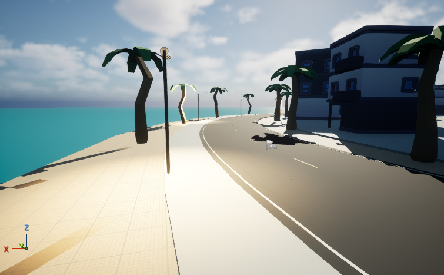

# After Hours review prototype — 20 October 2026

## Open the prototype

On this laptop: **http://127.0.0.1:3097/cruise/prototype**. Press **Play**. The default is automatic cruising, the existing licensed Countach and Night. Optional ride/lighting choices are folded below Play. Camera is at the upper right; change stations or save a station in the lower radio deck. Menu retains My Finds, saved stations, postcards, places, garage and settings. Settings → Listen without 3D retains the mounted radio owner.

**Along the drive** opens the house/demo business directory. It also exposes a downloadable, explicitly labeled local test observation file. No purchase, transfer or payment is enabled. **Phone & TV** explains system mirroring and enables an optional presentation mode; it is not a Cast device picker or paired remote. `?tv=1` starts that presentation treatment.

The server listens on port3097 on this laptop. A same-Wi-Fi phone can *try* `http://10.0.0.168:3097/cruise/prototype`; address/firewall and physical-device compatibility are unverified. `127.0.0.1` on a phone points to the phone itself. No public deployment or firewall change was made.

Restart from `D:\10-VENTURES\12-buena-onda\cruise-os-20261015`:

```powershell
$env:CRUISE_DIST_DIR='.next-cruise-prototype-final-build'
node node_modules/next/dist/bin/next start --hostname 0.0.0.0 --port 3097
```

Rebuild with the same `CRUISE_DIST_DIR` before starting if source changes. Do not use a different build directory for the server. The preserved prior visual preview is port3096 `/cruise/os?visual=rooms`; its frozen bundle is separate.

The successful 20-minute trial bundle is separately preserved in `.next-cruise-prototype-build` (ID in `tested-build-id.txt`). The final bundle corrects the generic share destination and removes the prototype radio hint after 45 seconds or after opening the station directory; these final UI changes have their own [smoke evidence](final-smoke.json). Neither changes the motion/audio implementation used in the long trial. Final build ID is in `final-build-id.txt`.

Measured trial: **1,203.1 seconds, 17.24 km, 240 samples**, no page exceptions and media time advancing across every saved interval. At1280×720 with Auto quality, sampled one-second FPS averaged 49.2, range 37.1–59.1; actual renderer DPR adapted between 0.85 and 1.0. The capture’s WebGL renderer is Intel UHD630 / ANGLE D3D11. This is not locked 60 FPS, physical mobile validation or an audible-speaker test. See [performance and limitations](PERFORMANCE.md).

Review [18seconds of actual browser gameplay](capture/cruise-drive-18s.webm), [unobstructed cockpit](capture/prototype-matching-cockpit.png), [matched prior cockpit](capture/before-matching-cockpit.png), [qualified roadside campaign](capture/qualified-world-ad.png) and [business card](capture/business-card.png). Video contains no broadcast audio. Its camera/route position was staged in the actual interactive scene; it is not the uninterrupted performance trial.

## What existed and what changed

Reused: the Next14 / React18 / R3F application, 19,642.96m OSM-derived Miami route, chunk loading, actual Countach model/cabin, radio owner, Human Radio catalog/adapters, metadata provenance, My Finds and local presets, postcards, camera modes, quality settings, sunset transition (default2,400seconds), existing geometric ad measurements and campaign roster. Colony recessed-room experiment is enabled on this route. No engine migration or framework replacement occurred.

Added only behind the new route/optional props:

- A single Play entry; optional garage/lighting remains available. Default cockpit and automatic cruising are retained.
- A frame-rate-independent spring-damper presentation for small road heave, acceleration/braking pitch and cornering roll; steering follows route curvature. Tires remain separate from the sprung body. This is an authored road micro-profile, **not a collision-based tire/suspension simulator**.
- Actual Countach steering geometry separated into an oriented pivot:8,114triangles across7material parts. The normalized source mesh and triangle inventory remain intact. Wheel steering and rolling use the existing route/odometer. The source CC BY4 attribution remains in the application.
- Opaque clone-owned Countach tire materials and a subtle procedural contact decal. Original cached materials and old route appearance remain intact. No fabricated hands or new vehicle asset.
- Existing house/demo campaign surfaces from the start of the prototype drive, a local business inspection directory, and separate opportunity/activation records. The local bridge bypasses legacy production ad telemetry. See [business integration](../../os/PROTOTYPE-BUSINESSES.md).
- Phone/TV mirroring help and optional six-second idle presentation. No working-looking Cast control, remote GPU, receiver, pairing or multiplayer claim.
- Correct route boundaries: no duplicate website navigation/global player, site marketing telemetry excluded as on Human Radio, prototype station shares return to the prototype.

No Gran Turismo physics repository was found in the earlier bounded inventory, and no GT game code or assets were imported. Separate sprung-body/wheel presentation was informed by the public [cannon-es vehicle implementation](https://github.com/pmndrs/cannon-es/blob/master/src/objects/RaycastVehicle.ts); this prototype uses its own small presentation model and does not add that physics dependency.

Original `/cruise`, `/cruise/os`, Human Radio and historical build bundles are preserved. The Avenue’s numbered inventory/claim/buyout implementation is neither replaced nor enabled. Its coordinates are not silently reassigned to Miami ad locations.

## Advertising measurement contract

Existing Miami checks sample about every 250 ms, require camera-facing/frustum/near-distance visibility, projected screen dimensions and conventional-geometry occlusion probes. A viewable surface must be fully framed, facing>.35, at least.003of the viewport, with occlusion≤.2. The stricter readable estimate requires facing≥.55, zero sampled occlusion and at least150×62CSSpixels for billboards or140×58for other formats. The bridge then requires two continuous seconds of qualification. These thresholds are **geometric heuristics**, not verified human readability, attention, unique reach or billable impressions.

One opportunity per continuously qualifying encounter; qualification loss allows a subsequent encounter. Deliberate inspections are separate, with 600 ms repeated-activation suppression. Hidden documents, modal/radio focus and disabled measurements invalidate qualification. Latest 100 events are bounded in memory; export labels all records DEMO / TEST and has no music profile or persistent listener identifier. Directory browsing does not prove that a roadside placement was seen. Existing production application telemetry outside this local recorder must be reviewed separately before launch.

Independent final screenshot review confirmed that a thin streetlight pole crosses the qualifying billboard despite its zero sampled-occlusion value; its headline is readable in the screenshot, while the smaller supporting copy is not. The ray samples can miss thin obstructions, and persistent HTML controls are not a per-pixel occlusion mask. Keep this an estimated opportunity metric and validate placement/readability with people before commercial reporting. No billing is attached to these observations.

## Epic / native Unreal checkpoint

Authoritative native foundation located: `cruise-publish-20261006/.vercel/cinema-probe/CinemaProbe.uproject`; engine `UE_5.8`, actual version5.8.3 CL58210709. ModelContextProtocol and AllToolsets are installed engine components. AllToolsets was enabled only in that project after backup. This Codex session used the existing local StreamableHTTP client against `http://127.0.0.1:8000/mcp`; it did not pretend to install the Claude Code marketplace plugin.

Actual live operations: initialize/tools-list; list_toolsets/describe_toolset; read 8 Entry actors/current level; find 19 CruiseWorld assets; list/read engine-provided agent skills; duplicate, **explicitly save**, load the review map; capture an actual rendered viewport. No cached-catalog-only connectivity claim. MCP requests and responses are retained alongside this report. A later restart successfully ran the official `ModelContextProtocol.GenerateClientConfig Codex` command and generated project-local `.codex/config.toml` (59 bytes), with `[mcp_servers.unreal-mcp]` pointing only to `http://127.0.0.1:8000/mcp`. Existing client settings were preserved; this running Codex session was not restarted to expose the namespace. The existing per-call local client supplied the successful earlier live queries. Endpoint binding was verified as 127.0.0.1. The editor is now closed, so the endpoint is offline.

Recovery: `cinema-probe/recovery/prototype-20261020-231440` contains the original project/config/map. Original map SHA256:
`DA6586C477F9BBF9918D7896781C14A9717E8A6E63E7123A93F13B8CCBCB1CB0`.

Saved copy: `/Game/BuenaOndaPrototype20261020/Lvl_WaterfrontReview`,1,167,454bytes. Loaded with map check 0 errors / 0 warnings. The first duplicate was mistakenly closed before saving; it was repeated and explicitly saved, with the original hash unchanged. That editor was saved and closed before browser builds to avoid exhausting the 16 GB laptop. A final rendered restart (owned PID 3216, run `prototype-20261021-002515`) was stopped before further scene mutations when its log reported only 94.33 MB system virtual-memory headroom (24,275.95MB used /24,370.28MB total; process physical3,534.16MB). Its queued catalog read did not complete, and is not claimed as another verified connection. The original map hash and saved review-copy size were rechecked after stopping. No new night map, signs or material upgrade was saved during that restart.



This is a755×467rendered viewport, **not1280×720full-frame proof**. It shows the current low-poly daytime foundation, without a moving vehicle (PIE was not started). Its scripted route is a roughly 77-second waterfront circle, not the web route or a 20-minute varied native scene. No native night/material/advertising upgrade, native radio audibility, physical TV test or sustained native performance pass is claimed. The native project was launched with NoSound for inspection. Reopen its saved copy in UE5.8 to review; original map remains available.

## REA, Ghidra and visual references

REA’s documented Codex dry-run was actually attempted; npm returned ENOTCACHED. The elevated retrieval retry was interrupted before a result. No package/doctor/Evidence record or client configuration was created. Exact attempt: [REA attempts](rea/ATTEMPTS.md), [readiness and source decision](REA-READINESS.md). Ghidra/JDK were not found in bounded conventional checks and were not installed; this owned JavaScript audio-lifecycle question did not justify native decompilation. Direct source inspection plus media-clock browser checks were used instead. No source/assets recovered from a third-party executable are claimed.

`retrovideonet.mp4` was not found in the inspected workspace/conventional paths. The four YouTube links yielded metadata through yt-dlp, **not inspected footage**: Cyberpunk gameplay, a GT7 Porsche video, a Forza/DLSS uploader claim and a Nightcall music upload. None establishes rendering technique, frame rate or Gaussian splats. No scene-matched multi-view capture/splat asset exists here, so a legitimate same-route mesh/splat comparison remains blocked; no unrelated scenery or projection was substituted.

## Evidence and remaining gates

See [browser results](browser/results.json), [build log](build.log), [focused tests](tests.log) and [playtest protocol](PLAYTEST.md). Browser validation records decoded media progression, not audible speaker output. Physical phones, phone lock/background behavior, actual TV audio/picture/reconnection and couch-distance readability remain unverified. System mirroring continues to render on the phone; a receiver does not confer desktop GPU power. Native streaming hosting was not provisioned or benchmarked.

Validation completed: production compilation/type checking,36 focused tests plus10 follow-up input/atmosphere tests (some overlap),20-minute moving trial, three explicit station selections (Jolt/NTS1/dublab), camera and 3D-lifecycle continuity, two viewport layouts, save/reload persistence,45-second hint dismissal, idle presentation recovery, and a controlled stream/metadata failure followed by Jolt recovery. [Recovery results](recovery/results.json) distinguish the deliberately blocked dublab fixture from the successful real dublab playback trial. The share fallback test deliberately disables native Web Share and checks the actual clipboard path; no OS share-sheet test is claimed. Existing repository lint/config warnings remain; see the successful final build log.

The [exported business observations](capture/business-demo.json) contain an Onda Tropical world opportunity and a separate Branches Vintage House directory activation. Different campaigns/surfaces are intentional: no attribution or conversion relationship is inferred. The actual qualifying sample was about205×82CSSpixels with zero sampled occlusion. Capture diagnostics also recorded a 215.5 ms worst ad-measurement call during warmup; sample FPS does not prove stutter-free rendering. Profile that path before scaling inventory.

Orchestration: root alone owned web integration and the live editor. Bounded agents `/root/finds`, `/root/station_audit` and `/root/metadata` handled business/TV code, inventory/motion tests/independent screenshot review, and REA readiness/source inspection. They used inherited session models; no unavailable Opus, proprietary GT implementation or paid image/video model participation is claimed.

No paid asset, API generation, recurring service, payment or public deployment was started in this milestone. Existing laptop/local serving introduces no newly purchased service; cloud remote-rendering costs remain unquoted and unmeasured. Do not call remote Unreal streaming free.

Remote rendering would additionally require a running GPU application/encoder, signaling and usually relay infrastructure, secure delivery and measured concurrency/bitrate. Its video bandwidth alone is about.45×bitrate-in-Mbps GB/hour (for example 8 Mbps≈3.6GB/hour, illustrative arithmetic, not an observed Cruise bitrate). A desktop native screenshot does not establish streaming latency or receiver compatibility. No hosting plan was selected, so a recurring dollar estimate would be speculative. Station commercial/embedding terms, ad association and vehicle/brand rights need a launch-specific review; existing asset credits are preserved, not a blanket commercial clearance.

**Recommendation:** continue development of the Unreal visual stretch while conducting a supervised browser prototype review. This is not a finished cinematic/TV launch. Prioritize measured listening continuity and physical phone/TV handoff, then a route-matched high-quality native street before expanding the world. The current native scenery and short loop do not meet the requested visual/session milestone. Use the8–12-person directional test before choosing further investment; no participants or advertisers have been contacted.

## Native blocker and next safe checkpoint

The exact blocker is system memory/commit headroom during the rendered editor restart, not a missing Cruise project or an unavailable engine plugin. No other applications were killed, paging configuration changed or GPU service purchased. The native night/ad treatment remains incomplete. Next session should first establish enough working memory, reopen the saved review map, make a fresh named copy before scene mutations, and verify one live read after all toolsets initialize. `scripts/native-mcp-probe.mjs` is prepared for that read-only inventory but was not run after the aborted restart. Do not infer that the saved review copy has a cinematic visual upgrade.

## Remaining work, ranked

1. Validate actual phone listening/background/lock behavior and same-network phone-to-TV mirroring with audio, disconnect and reconnect. No hardware path is certified yet.
2. Run the planned listener/advertiser sessions to test voluntary listening, return visits, unassisted operation and whether placements fit the experience. Technical playback duration is not retention research.
3. Reduce initial ride readiness time and profile ad-measurement spikes; review thin occluders and supporting-copy readability before commercial exposure reporting.
4. Resume one native night street only after establishing safe authoring memory headroom. Current native geometry and loop do not meet the cinematic milestone.
5. Complete launch-specific station/asset/ad-rights review and commercial terms; keep payments and ownership transfers inactive.
6. Consider a receiver/phone remote, splats or larger scenery only after the first five gates provide evidence for that investment.
